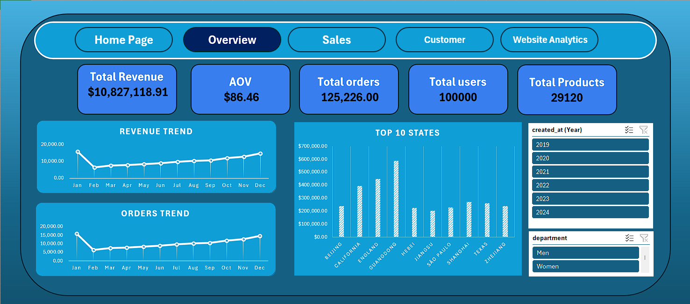
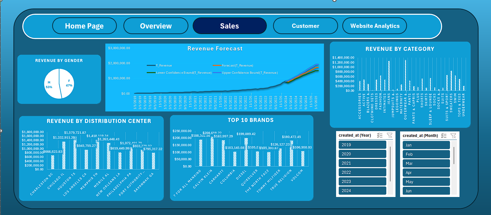
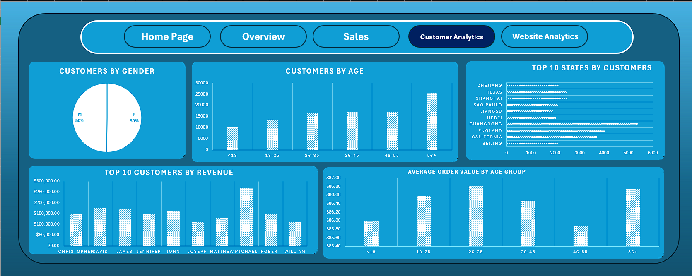
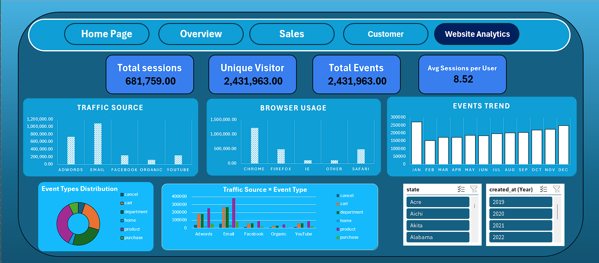

# 📊 Looker E-commerce BI Dashboard (Excel)

A 5-page interactive business-intelligence dashboard built **entirely in Excel** (Power Query, Power Pivot, DAX, Pivot Charts, Slicers) on the public [Looker E-commerce BigQuery dataset](https://www.kaggle.com/datasets/mustafakeser4/looker-ecommerce-bigquery-dataset). It answers four questions: *how is the business performing, what sells, who buys, and where does web traffic come from?*

## Executive Summary

- **A large, growing apparel retailer:** $10.83M revenue from 125,226 orders (AOV $86.46), 100,000 users and 29,120 products. Monthly revenue grew from near zero in 2019 to ≈ $0.8M by the end of 2023.
- **Demand is spread out, with no single point of dependency:** the top 3 regions make ≈13% of revenue, and the best brand makes <2%.
- **Basket size does not depend on age:** AOV is $85.9–$86.8 for every age group.
- **Email and Adwords drive most site activity** (≈ 75% of events); Organic is only ≈ 5%.

## Data & Model

| Table | Description |
|---|---|
| Users | Age, gender, location |
| Orders / Order Items | Purchases, dates, product-level sales |
| Products | Brand, category, department |
| Inventory Items | Stock linked to products |
| Distribution Centers | Warehouse locations |
| Events | Sessions, traffic source, browser, event type |

**What I did:** loaded and shaped the tables with **Power Query**, related them in a **Power Pivot data model**, wrote the KPI measures in **DAX**, built the pages with Pivot Charts and **slicer-driven navigation** (year, month, department, state), and added an Excel **time-series forecast** with confidence bounds.

## Key Findings

*Values marked "≈" are read from the dashboard charts.*

### Overview
- $10.83M revenue · 125,226 orders · AOV $86.46 · 100,000 users · 29,120 products.
- Top regions by revenue: **Guangdong ≈ $0.59M**, England ≈ $0.45M, California ≈ $0.39M. The top 3 are ≈ 13% of revenue, so geography is diversified across China, the UK, the US and Brazil.

### Sales
- **Gender:** customers are 50 / 50 but revenue is **53% male / 47% female**, so male customers spend slightly more.
- **Categories:** *Outerwear & Coats* and *Jeans* lead (≈ $1.2–1.3M each).
- **Distribution centers:** Houston is the top performer (≈ $1.58M), followed by Memphis and Chicago; Charleston is the lowest (≈ $0.67M), a gap of about 2.4×.
- **Brands:** the top 10 are each $100–210K (Calvin Klein ≈ $209K), so no brand dependency.
- **Forecast:** the series shows strong growth, reaching ≈ $0.8M per month before the forecast window, and projects ≈ $1.7M per month by early 2025.

### Customers
- Age mix: the 56+ group is the largest (≈ 25K customers), though it is also the widest age band.
- **AOV is flat across ages ($85.87 – $86.80, about ±0.6%)**: age is not a pricing or targeting lever.
- Customer geography mirrors revenue geography (Guangdong ≈ 5,400 customers, England ≈ 4,000, California ≈ 3,700).

### Website
- 681,759 sessions · 2.43M events · 8.52 sessions per user.
- **Email is the largest traffic source (≈ 1.08M events, ≈ 44%)**, then Adwords (≈ 0.73M); Facebook and YouTube ≈ 0.23M each; **Organic ≈ 0.12M.**
- Chrome is ≈ 50% of events; Firefox and Safari ≈ 20% each.
- Product-view events lead the funnel and purchase events are the smallest of the main steps. Conversion looks similar across sources, so Email wins on **volume**, not on better conversion.

## Recommendations

1. **Invest in Organic/SEO:** the business depends on paid and owned channels (Email + Adwords).
2. **Don't segment pricing or promotions by age;** AOV doesn't differ. Segment by region and category instead.
3. **Review low-revenue distribution centers** (Charleston, New Orleans, Savannah) against Houston and Memphis.
4. **Double down on Outerwear and Jeans** while keeping the long tail of brands.

## Known Issues & Fixes (to do before publishing)

These are weaknesses I found when reviewing the workbook. Fix them in the `.xlsx`, then delete the line.

1. **"Revenue Trend" looks identical to "Orders Trend"** (same shape, same 0–20K scale). At an AOV of $86, monthly revenue should be ~86× larger. The chart's measure likely points to the wrong field.
2. **"Unique Visitor" (2,431,963) equals "Total Events"** and is higher than total sessions (681,759). It is counting events, not distinct users. 8.52 sessions per user implies ≈ 80K users.
3. **"Top 10 Customers by Revenue" is grouped by first name** (Michael, David, James…), so it adds up many different people. Group by `user_id`.
4. **The "AOV by Age Group" axis starts at $85.40**, which exaggerates a ~1% difference. Start the axis at 0.
5. **Monthly trends pool all years together** (Jan–Dec across 2019–2024), so growth and seasonality are mixed. Plot a Year-Month timeline instead.
6. **"Top 10 States" mixes states, provinces and a country-level region** (England). Label it "Top 10 Regions".

## Dashboard Preview

## Tools

Microsoft Excel · Power Query · Power Pivot · Data Model · DAX · Pivot Tables / Charts · Slicers

## Author

**Mohamed Mahfouz** · Data Analyst · [GitHub](https://github.com/mohamedmahfouz604) · [LinkedIn](https://www.linkedin.com/in/mohamed-mahfouz-434283357)

